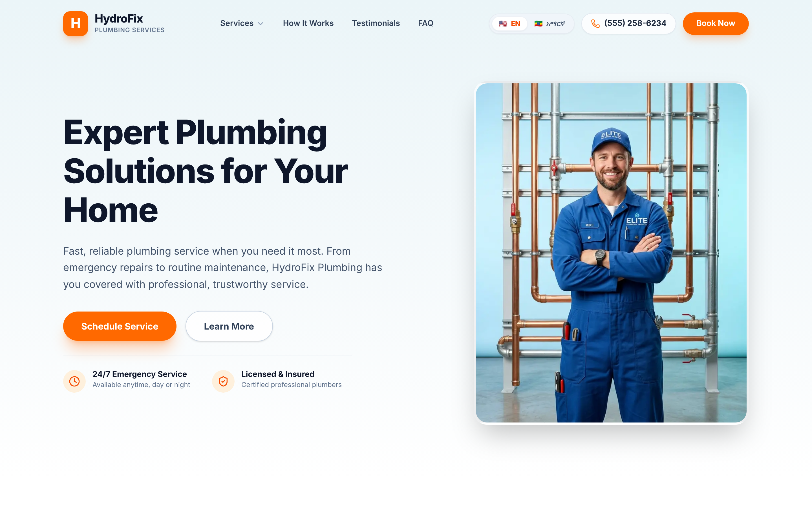
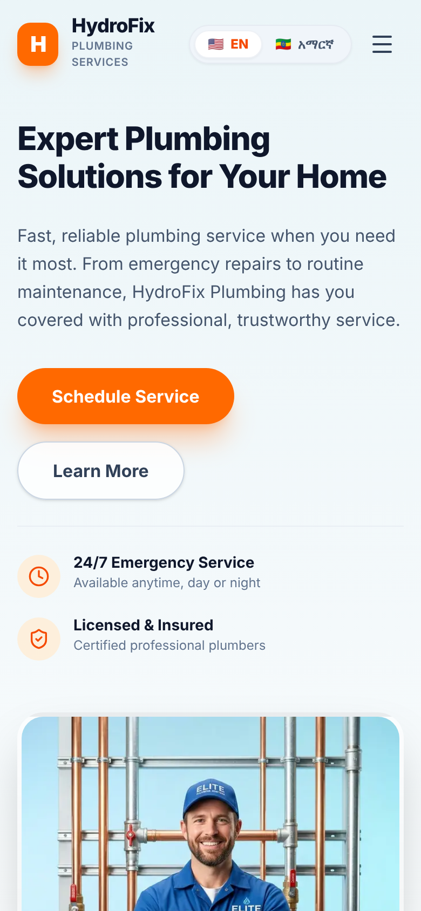
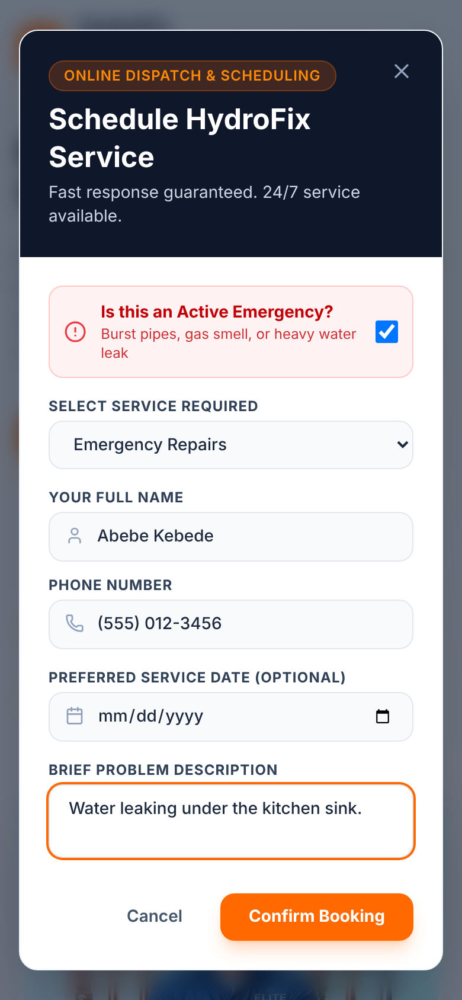
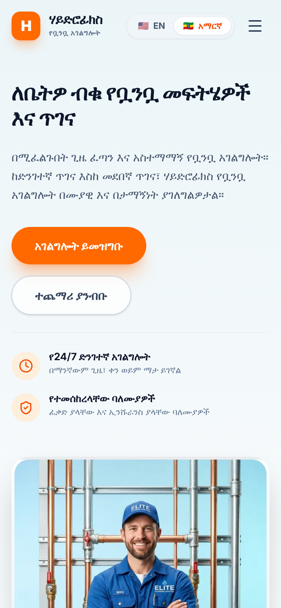

# HydroFix — a bilingual website for a plumbing service

HydroFix is a one-page marketing and booking site for a residential and commercial plumbing service. It is built for homeowners who need a plumber, often urgently, and who may want to read the site in English or in Amharic. I designed it to do one job well: get someone with a leaking pipe from worry to a booked visit in as few steps as possible, in the language they're comfortable in.

**Live site:** [plumbing-theta-tan.vercel.app](https://plumbing-theta-tan.vercel.app)

| | |
|---|---|
| **Design** | Fraol Tamrat: research, concept, visual system, UX and content structure |
| **Development** | Claude Code, working from my design and under my direction |
| **Client** | A plumbing service business. "HydroFix" is the working brand; the real business details are still to come (see [Status](#status)) |
| **Stack** | Next.js 16 (App Router), React 19, TypeScript, Tailwind CSS 4, deployed on Vercel |

## Screenshots



<p>
  
  
  
</p>

*Phone, left to right: the home page in English, the booking form filled in as an emergency, and the home page in Amharic.*

## The brief

The people using this site are not browsing. Most of them have a problem right now: water under the sink, a drain that won't clear, no hot water. Some of them are in a real emergency. They're usually on a phone, often stressed, and about to let a stranger into their home.

They also don't all read the same language. The site serves an Ethiopian audience, so it had to work fully in both English and Amharic. That meant everything a visitor reads, not just the navigation.

So the design had three problems to solve:

1. **Speed.** Someone in an emergency has to find the way to call or book within seconds, wherever they are on the page.
2. **Trust.** A first-time visitor has to believe this business is licensed, reliable and fair before they hand over their phone number.
3. **Language.** An Amharic reader should get the same site, with the same quality, as an English reader. Not a translated afterthought.

## The concept

**One colour means "get help."** The whole site is built on a calm, cool base, and a single strong orange is kept for the actions that get a plumber to your door.

The rules that follow from that:

- **Colour.** The base is a pale ice blue (`#EBF5F8`) fading to white, with deep navy (`#0B192C`) for text, the footer and the modal headers. It's clean and steady, the opposite of the panic the visitor arrives with. Orange (`#FF6500`) is the only accent. It marks *Book Now*, *Schedule Service*, the phone links, the icons and the active language. A soft peach (`#FFF6F0`) holds icons so the orange can sit on the page without shouting. Red appears only when a visitor marks their own request as an emergency.
- **Type.** Plus Jakarta Sans for Latin text, set heavy and tight in headlines so the promise reads at a glance. For Amharic the site switches to Noto Sans Ethiopic, so Ge'ez script renders properly instead of falling back to a generic font or empty boxes.
- **Layout.** One page, ordered the way a worried person thinks: *Can you fix this?* (hero and services) → *What happens if I call?* (how it works) → *Can I trust you?* (testimonials) → *What about…?* (FAQ) → *How do I reach you?* (footer). Rounded cards, generous spacing and centred section headings keep each step easy to scan on a small screen.
- **What I refused.** I didn't allow Amharic to be a machine-translated layer: it's content that has to be written, the same as the English. I didn't let a missing translation leave a gap: if an Amharic string is empty, the English one shows instead. And I didn't spread the accent colour around for decoration, because the moment orange shows up everywhere it stops meaning "act here."

## Design decisions

**The phone number never leaves the screen.** The header is fixed and turns solid white once you scroll, with the phone number and *Book Now* always in view. On a phone the number moves into the menu next to a full-width booking button. Someone in an emergency shouldn't have to scroll back up to find a way to call.

**Emergency comes first in the booking form.** The first thing in the form is a single question: *Is this an active emergency?* Ticking it turns the panel red, and the confirmation then labels the request as an immediate dispatch. The visitor tells the business how urgent it is in one tap, before typing anything.

**Only ask for what's needed to call back.** The form needs a name and a phone number, and nothing else is required. Date and notes are optional. Every extra required field is a reason to give up and try another plumber.

**Every service leads straight to booking.** Each service card opens a detail view with what's included, a direct line to dispatch, and a *Book [service]* button that opens the booking form. Reading about a service and booking it are one continuous path.

**Trust shows up before the sales pitch.** "24/7 Emergency Service" and "Licensed & Insured" sit right under the hero buttons, and a short four-step *How It Works* explains what happens after you call. People are letting someone into their home, so the reassurance comes early, not buried in the FAQ.

**Language is one tap away and stays put.** The EN / አማርኛ switch sits in the header on every screen size, with a flag and the language's own name so either reader recognises it. The choice is remembered on the next visit, and the page's `lang` attribute updates with it, so screen readers and browser tools know which language they're reading.

**A small celebration at the end.** When a booking is confirmed, the form gives way to a clear summary (service, urgency, date) and a short burst of confetti. It tells a stressed visitor, without any doubt, that their request went through.

## How it was built

I wrote the design: the brief, the visual reference and direction, the section structure and content, and the rules for how the two languages should work. Claude Code implemented it from those written instructions, in Next.js and Tailwind. I reviewed the result against the design and directed the changes.

## Status

**Finished**

- The full one-page site: header, hero, services, how it works, testimonials, FAQ and footer
- The service detail view and the booking form, including the emergency toggle and the confirmation screen
- English and Amharic for every piece of interface text and content, with Ethiopic font support and English fallback
- Responsive layout from phone to desktop
- Deployed on Vercel

**Placeholder or pending**

- **Business details are placeholders.** The phone number (a 555 number), email (an example.com address), street address, opening hours, the service area, and claims like response times, warranties, insurance amounts and payment options are all stand-ins until the client confirms the real ones.
- **Testimonials and photos are placeholders.** The three customer quotes, names and portraits are sample content, not real reviews. The hero photo shows a different brand name on the uniform and will be replaced.
- **The booking form doesn't send anything yet.** It shows the confirmation screen, but no request reaches the business. It still needs to be connected to email, SMS or a booking system.
- **The Privacy Policy, Terms of Service and Contact Us links in the footer are empty.**
- **Service preselection.** Booking from a service's detail view should open the form with that service selected. Right now it always opens on Emergency Repairs.
- **Smaller items:** the language choice is stored in the browser, not in the URL, so there are no separate `/en` and `/am` pages for search engines yet. Animations don't yet respect the reduced-motion setting. `npm run lint` currently reports four errors.

## Run it locally

**Prerequisites:** Node.js 20.9 or newer, and npm.

```bash
npm install
```

```bash
npm run dev
```

Then open [http://localhost:3000](http://localhost:3000).

| Command | What it does |
|---|---|
| `npm run dev` | Start the development server |
| `npm run build` | Build for production |
| `npm run start` | Serve the production build |
| `npm run lint` | Run ESLint |

```
src/
├── app/            # layout (fonts, metadata), page, global styles and colour tokens
├── components/
│   ├── layout/     # Header, Footer
│   ├── sections/   # Hero, Services, HowItWorks, Testimonials, FAQ
│   └── ui/         # BookingModal, ServiceModal, LanguageSwitcher
├── context/        # LanguageContext: active language, t() lookup, English fallback
├── data/           # service, step, testimonial and FAQ structure
└── messages/       # en.ts and am.ts: all copy in English and Amharic
public/images/      # hero and testimonial photos (placeholders)
docs/screenshots/   # images used in this README
```

To change any copy, edit `src/messages/en.ts` and `src/messages/am.ts`. The Amharic file is typed against the English one, so a missing key shows up as a TypeScript error.
